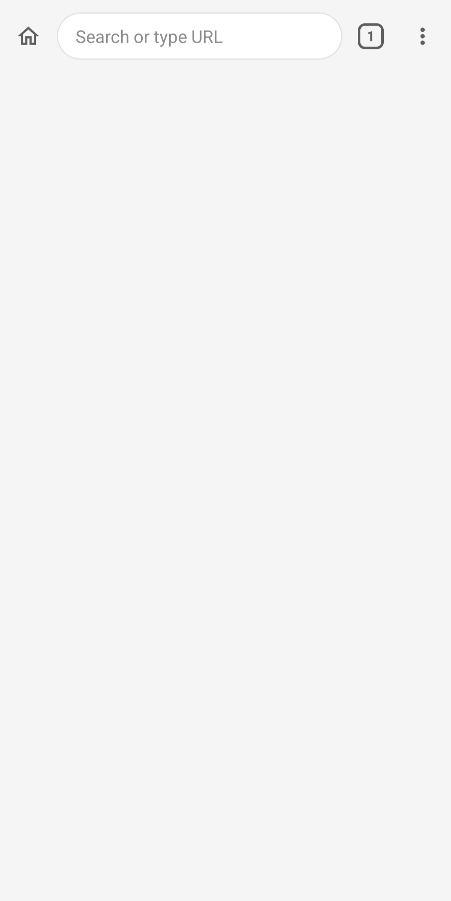
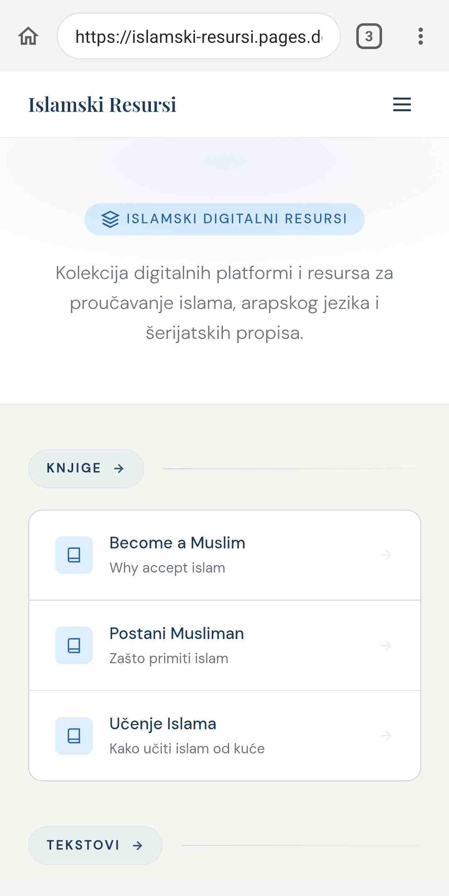
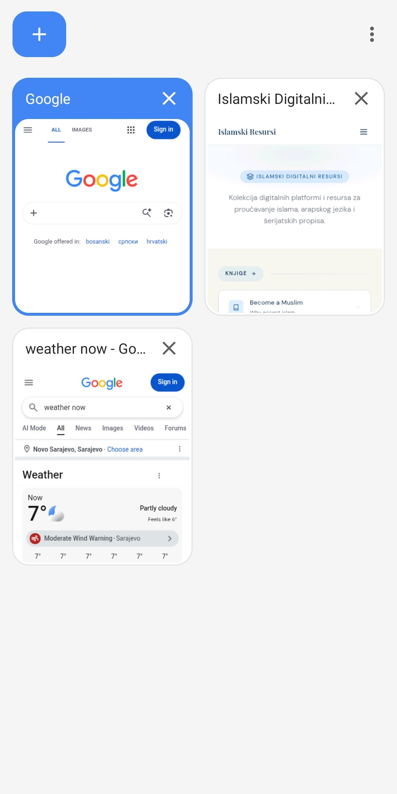

# Browser

**📱 Android:** [download the latest version (APK)](https://github.com/amarhusika/browser/releases/download/v1.1/browser.apk)

A tiny, fast Android browser built on the system WebView: no AppCompat, no
Material library, no tracking. The whole app is only ~50 KB. Made to use as little
battery as possible.

<p>
  
  
  
</p>

## Features

- **Tabs like Chrome.** A counter in the top bar shows how many tabs are open;
  tap it to see all tabs as cards (with a preview of each page), switch,
  close one (×) or close all. The blue **+** opens a new tab.
- **Home button** on every tab: goes back to a blank page.
- **Address bar** that takes a link or a Google search.
- **History**: every visited page grouped by day (Today, Yesterday, date).
  Tap to open, long-press to delete one entry.
- **Clear**: deletes cookies, cache, site storage, history and all tabs in one tap.
- **Share** the current page.
- Light and dark theme follow the system.
- Fullscreen video (rotates to landscape), file uploads, downloads to *Downloads*.
- Opens links, searches and shared text from other apps, and local `.html` files.
- Battery friendly: background tabs and the whole browser are paused when not
  visible; a crashed page reloads instead of crashing the app.

## Menu (⋮)

| Item     | What it does                                   |
|----------|------------------------------------------------|
| New tab  | Opens a blank tab and focuses the address bar  |
| Share    | Shares the current link                        |
| History  | Shows visited pages                            |
| Clear    | Wipes all browsing data and tabs               |

## Build

Requirements: Android Studio (or the Android SDK) with API 36, JDK 11+.

```bash
./gradlew assembleRelease
```

The APK is written to `app/build/outputs/apk/release/`.
Min SDK 26 (Android 8.0), target SDK 36.

## Project layout

```
app/src/main/java/com/amar/browser/MainActivity.kt   all of the app logic
app/src/main/res/layout/activity_main.xml           bar, tab switcher, history
app/src/main/res/drawable/                          icons and shapes
```
